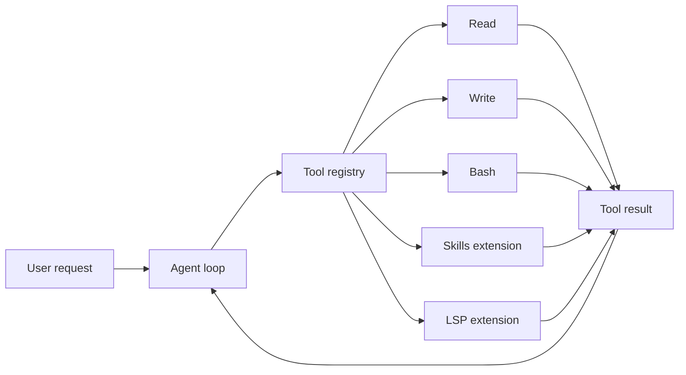
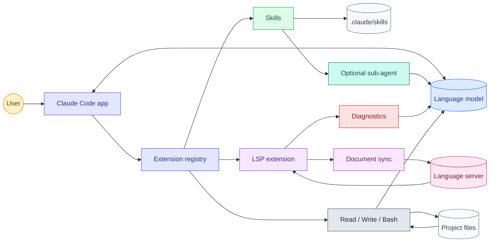
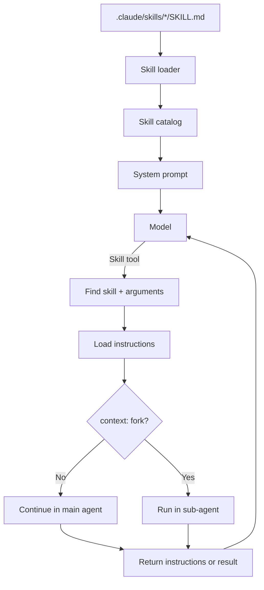
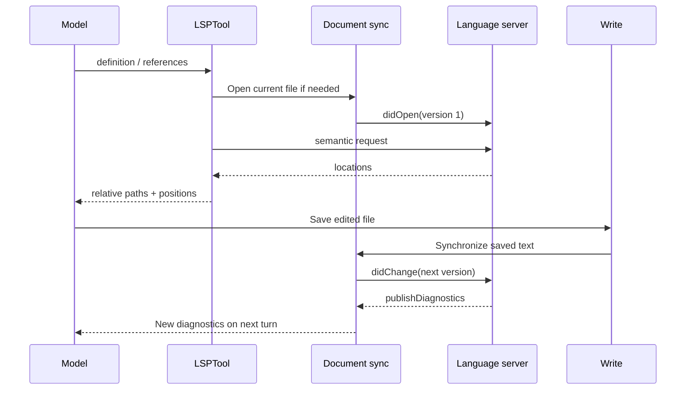

# Claude Code in Java

This project is a Java solution for the
[Build Your Own Claude Code challenge](https://codecrafters.io/challenges/claude-code)
by [CodeCrafters](https://codecrafters.io/).

The challenge builds an AI coding assistant that can understand a request,
call tools, inspect files, make edits, and continue until the task is complete.

## Challenge source

- [Challenge overview](https://codecrafters.io/challenges/claude-code)
- [CodeCrafters challenge repository](https://github.com/codecrafters-io/build-your-own-claude-code)
- [LSP exercise](https://github.com/codecrafters-io/build-your-own-claude-code/tree/main/extension_designs/lsp_exercise)

## Key notes

- Java application using the OpenAI-compatible SDK through OpenRouter.
- The agent keeps a conversation history while it works.
- Tools are registered behind a common registry, so new capabilities can be added without expanding the entry point.
- Built-in tools include `Read`, `Write`, `Bash`, `Skill`, and `LSP`.
- Skills are loaded from `.claude/skills`.
- LSP lookups support definitions, references, synchronized edits, and diagnostics.
- The LSP tool is always advertised; it reports configuration or server errors when unavailable.

## Extension architecture

The core agent does not need to know how a tool works. An extension only needs
to provide a description for the model and an execution path.



## General overview

The model decides what to do, while extensions provide focused knowledge and
actions. Results travel back through the same conversation.



Colors show the role of each part: blue is the model, green is Skills,
purple is LSP, and gray is direct file tooling.

## Skills extension

Skills turn a short command such as `/review` into reusable instructions.
They can receive arguments and optionally run in a separate sub-agent context.



## LSP extension

LSP gives the model semantic knowledge instead of simple text matching.
The shared document layer keeps the server aligned with files changed by
`Write`.



## Running

The challenge runner invokes the program with:

```bash
./your_program.sh -p "Your request"
```

Required environment variable:

```text
OPENROUTER_API_KEY
```

Optional variables:

```text
OPENROUTER_BASE_URL
CODECRAFTERS_LSP_URL
```

## Visual references

- [Language Server Protocol overview](https://microsoft.github.io/language-server-protocol/overviews/lsp/overview/) shows how editors, clients, and language servers cooperate.
- [LSP exercise](https://github.com/codecrafters-io/build-your-own-claude-code/tree/main/extension_designs/lsp_exercise) provides a concrete project for definitions, references, and diagnostics.
- [Claude Code skills](https://docs.anthropic.com/en/docs/claude-code/skills) explains how reusable instruction extensions work.
